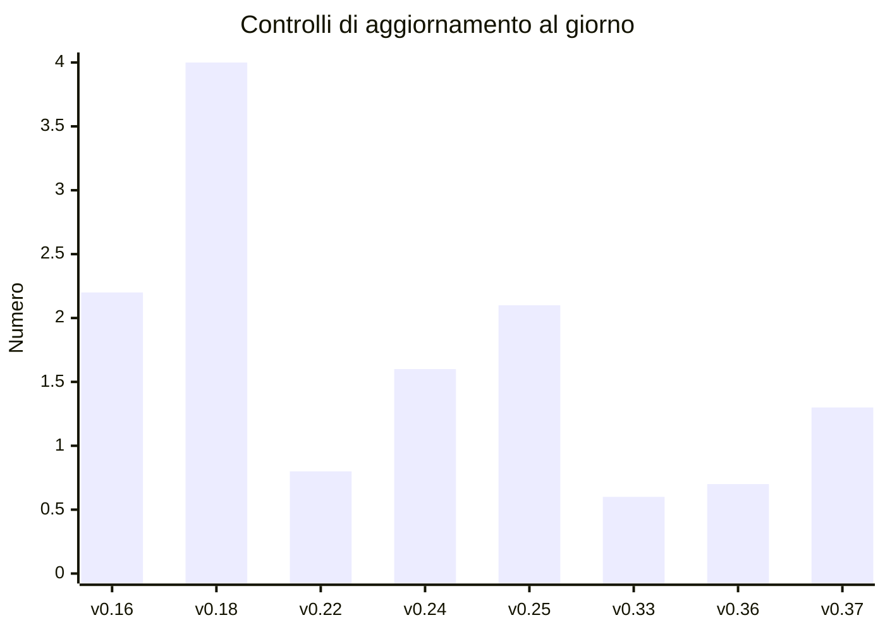
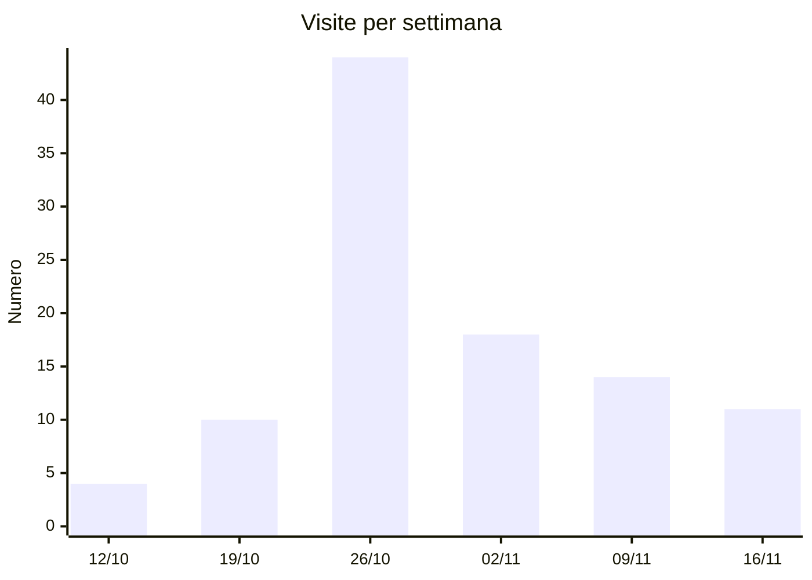

# Statistiche di Referto Volley

Aggiornate il 23/11/2026, ogni lunedì in automatico. I dati vengono da GitHub: l'app non invia nulla. Lo storico è in `github-stats.json`.

## In breve

- **Uso delle app desktop:** 1,3 controlli di aggiornamento al giorno con la v0.37.
- **Visite al repository:** 11 nella settimana del 16/11/2026, contro 14 della precedente.
- **Repository:** 0 stelle, 1 fork.

## Uso delle app, versione per versione

Ogni app desktop legge `latest.json` all'avvio, se il controllo aggiornamenti è attivo: i **controlli** sono avvii, non persone. Conta soprattutto il valore **al giorno**. Non comprendono la versione web e le app Android. Le versioni rimaste le più recenti per meno di un giorno non sono elencate, salvo l'ultima.

| Versione | Uscita | Giorni come ultima | Controlli | Al giorno | Windows | macOS | Linux | Android | iOS |
| --- | --- | --- | --- | --- | --- | --- | --- | --- | --- |
| v0.16 | 28/09/2026 | 1,8 | 4 | 2,2 | 4 | 3 | 4 | 2 | 1 |
| v0.18 | 30/09/2026 | 4,3 | 17 | 4,0 | 11 | 2 | 5 | 7 | 1 |
| v0.22 | 05/10/2026 | 2,4 | 2 | 0,8 | 2 | 3 | 4 | 3 | 1 |
| v0.24 | 07/10/2026 | 16,2 | 26 | 1,6 | 12 | 3 | 6 | 5 | 1 |
| v0.25 | 23/10/2026 | 8,0 | 17 | 2,1 | 14 | 6 | 6 | 5 | 6 |
| v0.33 | 02/11/2026 | 8,7 | 5 | 0,6 | 4 | 2 | 5 | 5 | 1 |
| v0.36 | 11/11/2026 | 5,4 | 4 | 0,7 | 3 | 2 | 3 | 5 | 1 |
| v0.37 | 16/11/2026 | 7,0 | 9 | 1,3 | 5 | 2 | 3 | 6 | 1 |

Le colonne per piattaforma sono i download dei pacchetti di installazione. Anche una versione appena uscita ne ha qualcuno per piattaforma, per prove o bot: conta ciò che supera quella soglia.

## Visite al repository

| Settimana dal | Visite | Persone* |
| --- | --- | --- |
| 12/10/2026 | 4 | 3 |
| 19/10/2026 | 10 | 9 |
| 26/10/2026 | 44 | 16 |
| 02/11/2026 | 18 | 9 |
| 09/11/2026 | 14 | 5 |
| 16/11/2026 | 11 | 9 |

\* Somma delle persone diverse di ogni giorno: chi torna in due giorni conta due volte.

## Da dove arrivano
Ultimi 14 giorni.

| Provenienza | Visite | Persone |
| --- | --- | --- |
| Google | 3 | 2 |

## Pagine più viste
Ultimi 14 giorni.

| Pagina | Visite | Persone |
| --- | --- | --- |
| `/` | 10 | 4 |
| `/releases` | 6 | 6 |
| `/blob/main/LICENSE` | 3 | 1 |
| `/blob/main/README.md` | 2 | 1 |
| `/compare/v0.35...v0.36` | 1 | 1 |

## Clonazioni

Copie del codice: 428 in 6 settimane. Sono in gran parte automatismi, quindi non indicano quante persone usano l'app.

